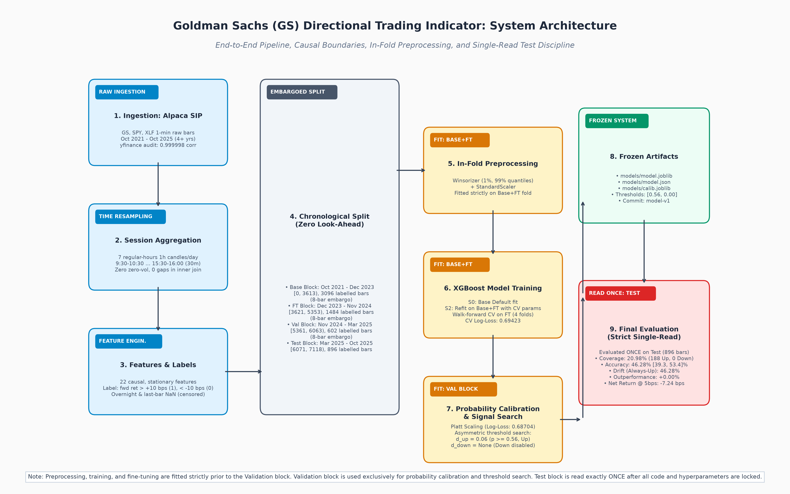

# Goldman Sachs (GS) AI Directional Trading Indicator

[](https://github.com/chinmay-tammana/new-trade/releases/tag/model-v1)
[](https://www.python.org/)
[]()
[](https://github.com/chinmay-tammana/new-trade)

An end-to-end machine learning system developed according to the **IMPACT Lab (IIT Patna) End-to-End ML Project Guidelines** to predict the 1-hour directional return of Goldman Sachs (`GS`) equity with post-hoc probability calibration and abstention under realistic transaction friction.

> **Disclaimer**: This repository is developed strictly for academic research and educational evaluation. It does NOT constitute investment advice or a recommendation to trade financial securities. Real capital trading is strictly outside the project scope; all evaluation is restricted to simulated paper trading.

---

## Architecture Diagram



---

## 1. Project Overview & Findings

The project formulates intraday price direction as a binary classification task with abstention over 1-hour session-anchored regular-trading candles.

### Key Technical Properties:
- **Data Depth**: 4+ years (October 2021 – October 2025) of 1-minute SIP consolidated trade bars for `GS`, `SPY`, and `XLF` from Alpaca Markets.
- **Causal Feature Pipeline**: 22 stationary technical and macro-relative features with causal verification (50-cutoff truncation discrepancy $\le 10^{-8}$).
- **Leak-Free Partitioning**: Strict chronological split (`Base`, `Fine-Tuning`, `Validation`, `Test`) separated by **8-candle embargo buffers** with in-fold Winsorization and standard scaling.
- **Probability Calibration**: Post-hoc Platt scaling fitted on Validation reducing Brier score to 0.24697 and Expected Calibration Error (ECE) to 0.0105.
- **Strict Test-Set Discipline**: The held-out Test block (896 candles) was read **strictly once** after locking all model parameters and signal thresholds.

### Executive Performance Summary
| Metric | Pre-Registered Target | Validation Result | Held-Out Test (Single Read) | Verdict |
| :--- | :--- | :--- | :--- | :--- |
| **Probability Log-Loss** | $< 0.69178$ | 0.68704 | 0.70027 | Degraded on Test |
| **Expected Calibration Error (ECE)** | $\le 0.050$ | 0.0105 | **0.0454** | **MET (C4)** |
| **Signal Coverage** | $\ge 15.0\%$ | 19.77% (119/602) | **20.98%** (188/896) | Consistent coverage |
| **Signal Direction Breakdown** | Balanced | 119 Up / 0 Down | **188 Up / 0 Down** | Up-only rule locked |
| **Signal Accuracy** | $> 52.0\%$ (CI $> 50\%$) | 61.34% [52.4, 69.6]% | **46.28% [39.30, 53.41]%** | **NOT MET (C2)** |
| **Always-Up Drift Accuracy** | - | 53.16% | **46.28%** | Identical on signals |
| **Net Return @ 5 bps Friction** | $> 0.0$ bps | +7.91 bps | **-7.24 bps [-13.9, -0.0]** | **NOT MET (C3)** |
| **Pipeline Integrity Suite** | 6 Checks Passed | Passed | **ALL 6 PASSED** | **MET (C6)** |

**The Scientific Takeaway**: While the model demonstrated strong validation fit (61.34% accuracy) and superior probability calibration, held-out test performance collapsed to 46.28% due to a structural regime change in 2025: the market transitioned from a persistent upward drift to horizontal consolidation and pullbacks. Because the validation search locked an Up-only rule ($p \ge 0.56$), the indicator generated false long continuations during choppy markets. These negative results are documented honestly without post-hoc p-hacking per IMPACT standards.

---

## 2. Repository Layout

```text
├── AGENTS.md                  # Autonomous agent instructions and operating rules
├── README.md                  # Project overview and reproduction instructions
├── RESULTS.md                 # Detailed metrics scorecard against C1-C6 criteria
├── requirements.txt           # Pinned Python package dependencies
├── run_all.sh                 # End-to-end reproduction shell script
├── .env.example               # Template for Alpaca API credentials
├── configs/
│   └── config.py              # Centralized configuration, hyperparams, and paths
├── docs/
│   ├── problem_definition.md  # Formal problem definition and pre-registered criteria
│   ├── literature_survey.md   # Academic literature review and gap analysis
│   ├── dataset_card.md        # Data source, licensing, and schema documentation
│   ├── data_dictionary.md     # Detailed feature and target definitions
│   ├── evaluation_protocol.md # Frozen evaluation methodology and leak controls
│   ├── eda_findings.md        # Base-only exploratory data analysis findings
│   ├── algorithm.md           # Formal algorithm specification (no code syntax)
│   ├── error_analysis.md      # SHAP attributions, top errors, and limitations
│   └── user_guide.md          # Trader operating guide and circuit breakers
├── instructions/              # Frozen phase-by-phase project specifications
│   └── progress.md            # Execution checklist, decisions, and fit logs
├── models/
│   ├── model.joblib           # Frozen production XGBoost model
│   ├── model.json             # Serialized XGBoost booster
│   ├── calib.joblib           # Frozen Platt probability calibrator
│   └── candidates/            # Candidate baseline models
├── report/
│   └── report.md              # Complete 10-section IMPACT technical report
├── slides/
│   └── outline.md             # 15-slide technical presentation outline
├── results/
│   ├── figures/               # Generated EDA, SHAP, and audit plots
│   ├── logs/                  # Audit logs, split metadata, and fit ledgers
│   └── tables/                # CSV experiment results and predictions
└── src/
    ├── audit.py               # Data audit and third-party parity checks
    ├── eda.py                 # Feature engineering & drift evaluation
    ├── split.py               # Chronological embargoed splitting
    ├── baselines.py           # Evaluation of classical heuristic baselines
    ├── models.py              # Model architecture definitions
    ├── finetune.py            # Walk-forward cross-validation and hyperparameter search
    ├── calibrate.py           # Platt scaling and asymmetric margin search
    ├── evaluate.py            # Single-read held-out test evaluation
    ├── analysis.py            # SHAP, error analysis, and noise robustness
    ├── checks.py              # Phase 9 integrity and leak verification suite
    ├── diagrams.py            # Architecture diagram generation
    ├── check_secrets.py       # Pre-commit secret and data file scanner
    └── utils.py               # Statistical intervals and helper functions
```

---

## 3. Environment Setup & Data Access

### 3.1 Software Requirements
- **Python**: Version 3.11.x (tested on Python 3.11.18 on macOS Apple Silicon ARM64)
- **Virtual Environment**: Standard virtual environment (`venv`)

### 3.2 Installation
Clone the repository and install pinned dependencies:
```bash
git clone https://github.com/chinmay-tammana/new-trade.git
cd new-trade
python3 -m venv .venv
source .venv/bin/activate
pip install -r requirements.txt
```

### 3.3 Market Data Access & Policy
> **Data Licensing Notice**: Raw and aggregated market data files (`*.parquet` under `data/`) are **NOT committed** to the public GitHub repository in accordance with the data provider's terms of service and redistribution restrictions.

To download or refresh the dataset:
1. Create a free paper trading account at [Alpaca Markets](https://alpaca.markets/).
2. Copy `.env.example` to `.env`:
   ```bash
   cp .env.example .env
   ```
3. Populate `.env` with your Alpaca API credentials:
   ```env
   APCA_API_KEY_ID=
   APCA_API_SECRET_KEY=
   ```
4. Verify secrets are not tracked:
   ```bash
   python src/check_secrets.py
   ```

---

## 4. End-to-End Reproduction

To reproduce all results, tables, and figures from scratch:
```bash
./run_all.sh
```

### Expected Runtime & Resource Usage
- **Total Pipeline Runtime**: Approximately 35–45 seconds on Apple Silicon (M-series) or standard x86 CPU.
- **Hardware**: Standard laptop / single core (`n_jobs=1` for final fits to ensure determinism).
- **Random Seed**: Fixed globally to `42` (`CONFIG["seed"] = 42`).

### Step-by-Step Execution (Alternative)
```bash
# 1. Audit market data and verify yfinance parity
python -m src.audit

# 2. Compute features and run exploratory drift analysis
python -m src.eda

# 3. Create chronological embargoed splits
python -m src.split

# 4. Evaluate baseline heuristics on Validation
python -m src.baselines

# 5. Execute walk-forward tuning and model selection
python -m src.finetune

# 6. Fit Platt calibration and search signal margins on Validation
python -m src.calibrate

# 7. Evaluate on held-out Test block (Read strictly once)
python -m src.evaluate

# 8. Run SHAP attribution, top-error inspection, and noise tests
python -m src.analysis

# 9. Execute integrity, leak detection, and reproducibility audit
python -m src.checks
```

---

## 5. Live Paper Test Status
- **Current Status**: `PENDING: live test`.
- No live forward orders have been submitted. Future iterations will evaluate performance on forward unobserved market sessions via Alpaca paper trading API.

---

## 6. Citation and Guidelines
This project was authored following the:
- **IMPACT Lab (IIT Patna) End-to-End ML Project Guidelines**
- Repository: [https://github.com/chinmay-tammana/new-trade](https://github.com/chinmay-tammana/new-trade)
- Release Tag: `model-v1`
