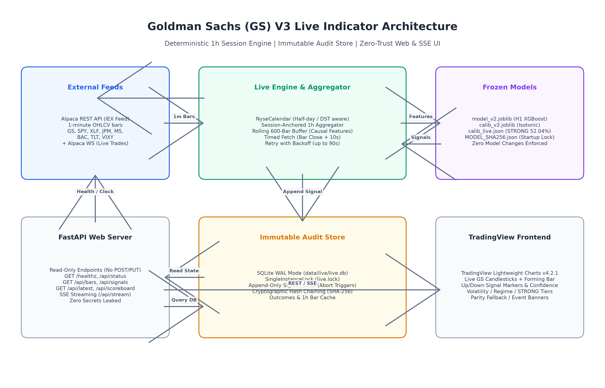

# V3 Live Architecture Specification

This document details the end-to-end production architecture of the Goldman Sachs (`GS`) AI Trading Indicator Live System.



## 1. System Overview

```
                      +-----------------------------+
                      |   Alpaca REST / WS Feeds    |
                      |  (IEX 1m bars / live trades)|
                      +--------------+--------------+
                                     |
                                     v
+-----------------------+     +-------------------------------+     +-----------------------+
|  Read-Only FastAPI    |     |   Live Engine & Aggregator    |     |    Frozen ML Models   |
|  - GET /healthz       | <---+   - NyseCalendar (DST/Half)   +---> |  - model_v2.joblib    |
|  - GET /api/status    |     |   - Session 1h Aggregator     |     |  - calib_v2.joblib    |
|  - GET /api/bars      |     |   - Rolling 600-Bar Buffer    |     |  - calib_live.json    |
|  - GET /api/signals   |     |   - Timed Fetch + Retry       |     |  - MODEL_SHA256.json  |
|  - GET /api/scoreboard|     |   - State Machine Loop        |     +-----------------------+
|  - SSE /api/stream    |     +---------------+---------------+
+-----------+-----------+                     |
            |                                 v
            |                 +-------------------------------+
            |                 |    Immutable SQLite Store     |
            |                 |  - data/live/live.db (WAL)    |
            |                 |  - SingleInstanceLock         |
            |                 |  - Append-Only (Triggers)     |
            |                 |  - SHA-256 Hash Chain         |
            +---------------> +-------------------------------+
            |
            v
+-------------------------------+
| Lightweight Charts Frontend   |
| - GS Candlesticks + Forming   |
| - Signal Markers + Bands      |
| - Regime / Volatility HUD     |
| - Parity / Event Banners      |
+-------------------------------+
```

## 2. Ingestion & Market Calendar (`src/live/calendar.py`)

- **NYSE Session Calendar**: Deterministic market open (09:30 ET) and close (16:00 ET).
- **Session-Anchored 1-Hour Schedule**:
  - Normal day (7 bars): `09:30-10:30`, `10:30-11:30`, `11:30-12:30`, `12:30-13:30`, `13:30-14:30`, `14:30-15:30`, and the 30-minute session close `15:30-16:00`.
  - Half-day awareness: On scheduled early close days (e.g., Black Friday 13:00 close), produces exactly 4 bars (`09:30-10:30`, `10:30-11:30`, `11:30-12:30`, `12:30-13:00`).
  - Daylight Savings Time: Explicitly localized to `America/New_York` using IANA timezone database.

## 3. Live Aggregator & Engine (`src/live/engine.py`, `src/live/aggregator.py`)

- **Rolling History Buffer**: Maintains a synchronized, memory-mapped rolling buffer of $\ge 600$ closed 1-hour bars across all 8 tickers (`GS`, `SPY`, `XLF`, `JPM`, `MS`, `BAC`, `TLT`, `VIXY`).
- **Timed Bar Ingestion**: Scheduled to trigger at bar close + 10 seconds.
- **Retry Mechanism**: Polls Alpaca REST API with exponential backoff (retry up to 90 seconds).
- **Late Flag**: If a bar requires $> 3$ minutes to ingest or if the engine restarts mid-session, the signal is generated and persisted with `late = 1`, excluding it from official evaluation.
- **Data Gap Handling**: If any context symbol is unavailable or bar aggregation fails, a safe abstain signal (`No signal (data gap)`, confidence 0.50) is emitted without crashing.
- **Forming Bar**: Listens to real-time Alpaca WebSocket trade stream for GS, maintaining an in-memory forming candle updated tick-by-tick for visual chart responsiveness.

## 4. Immutable SQLite Audit Store (`src/live/store.py`)

- **Database Path**: `data/live/live.db` operated in WAL (`Write-Ahead Logging`) mode with `synchronous = NORMAL`.
- **Single-Instance Process Lock**: Exclusive `fcntl` file lock on `data/live/live.lock` prevents concurrent duplicate processes.
- **Append-Only Triggers**: SQLite `BEFORE UPDATE` and `BEFORE DELETE` triggers raise `ABORT` errors on any attempted mutation of the `signals` table.
- **Cryptographic Hash Chaining**: Every emitted signal contains `prev_hash` (the SHA-256 hash of the previous record) and computes its own `hash = SHA256(canonical_json(record))`. Any modification of past records invalidates the cryptographic audit chain.

## 5. Read-Only Web API (`src/live/server.py`)

- **FastAPI Framework**: Read-only design exposing zero `POST`, `PUT`, or `DELETE` endpoints.
- **Zero Secrets**: Environment variables and Alpaca API keys are strictly forbidden from being returned by any endpoint or error traceback.
- **Server-Sent Events (SSE)**: `/api/stream` pushes real-time heartbeats, forming candle updates, and closed-bar signal events directly to connected browser clients.

## 6. Frontend Dashboard (`static/`)

- **Vendored Lightweight Charts**: TradingView Lightweight Charts v4.2.1 vendored locally in `static/vendor/` with license and notice files. Zero third-party CDN runtime dependencies.
- **HUD & Visual Hierarchy**:
  - Live candlesticks with real-time forming bar.
  - Directional signal markers (`Up` in green, `Down` in red).
  - Volatility prediction tier (`High`, `Normal`, `Low`).
  - Quantile return bands (10th and 90th percentiles).
  - Market regime badge (`Uptrend`, `Downtrend`, `Chop`).
  - Parity fallback banner: Clearly displays active IEX parity fallback status (`live_signals_enabled = False`).
