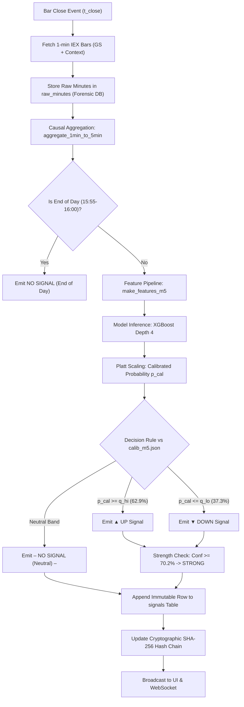

# Algorithm Specification: M5 (5-Minute) Decision Pipeline

The 5-minute directional inference engine executes the following steps in sequential order at each 5-minute interval:

## Step-by-Step Algorithmic Logic
1. **Timing Trigger**: At $t = \text{bar\_end} + 8\text{ seconds}$ (e.g. 09:35:08 ET), the live engine queries Alpaca REST for 1-minute IEX bars spanning the completed 5-minute interval.
2. **Forensic Storage**: All raw 1-minute bars are inserted into `raw_minutes` with composite key `(bar_start, symbol, timestamp)` before any processing occurs.
3. **Session-Anchored Aggregation**: `aggregate_1min_to_5min` maps trades into the 5-minute bar: open = first minute open, high = max, low = min, close = last minute close, volume = sum, and derives intrabar realized volatility, CLV, signed volume ratio, and trade share.
4. **Causal Feature Vector**: A rolling window of historical 5-minute bars is passed to `make_features_m5` to construct all 46 stationary features.
5. **Primary Tree Inference**: The winning shallow XGBoost model (`max_depth=4`, `n_estimators=120`, `learning_rate=0.03`, `tree_method='hist'`) evaluates the feature vector to generate raw class margin $\hat{z}$.
6. **Platt Probability Calibration**: Calibrated probability $p_{\text{cal}} = \sigma(a \hat{z} + b)$ is computed using the class-balanced logistic calibrator fit on pre-holdout OOF predictions.
7. **Signal Rule Application**:
   - If $p_{\text{cal}} \ge q_{\text{hi}}$ ($62.91\%$), output `Up`. Displayed confidence = $p_{\text{cal}}$.
   - If $p_{\text{cal}} \le q_{\text{lo}}$ ($37.28\%$), output `Down`. Displayed confidence = $1.0 - p_{\text{cal}}$.
   - Otherwise, output `No signal`. Displayed confidence = $50\%$.
   - Flag `is_strong = 1` if directional and confidence $\ge 70.15\%$ ($75\text{th}$ percentile of OOF signal confidence).
8. **Cryptographic Sealing**: The signal row is combined with `prev_hash` to compute the deterministic SHA-256 `row_hash` and inserted into `data/live/live_m5.db`. Attempting to modify or delete the row aborts with an SQLite exception.
